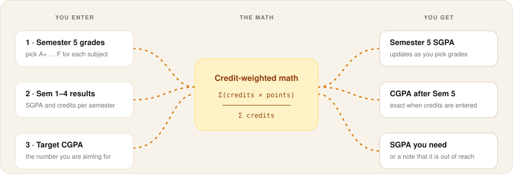

<div align="center">


<br/>

[](https://sgpa-cgpa-calculator-vit.vercel.app)
&nbsp;


[](https://github.com/durgesh-v-shukla/SGPA-CGPA-Calculator-VIT/commits/main)
[](https://github.com/durgesh-v-shukla/SGPA-CGPA-Calculator-VIT/stargazers)
[](#contributing)

**[Open the calculator](https://sgpa-cgpa-calculator-vit.vercel.app)** · [How it works](#how-it-works) · [Run it locally](#quickstart) · [Make it yours](#contributing)

</div>

---

## The 30-second pitch

Most grade calculators tell you what you got. This one also tells you **what you need**.

Pick your Semester 5 grades and your SGPA updates live. Type in the SGPA from your four earlier marksheets and you get your CGPA. Then enter the CGPA you want, and it tells you the exact SGPA you need this semester to reach it, or tells you honestly that it can't be done.

It runs entirely in your browser. No login, no backend, nothing to install.

| | A basic calculator | This one |
|---|:---:|:---:|
| SGPA from subject grades | ✅ | ✅ |
| CGPA across semesters | ✅ | ✅ |
| **"What SGPA do I need for a 9.3?"** | ❌ | ✅ |
| Tells you when a target is out of reach | ❌ | ✅ |
| Works with only your SGPAs (no credits needed) | ❌ | ✅ |
| Exact credit-weighted CGPA when you do know credits | sometimes | ✅ |
| Red warnings for impossible inputs | ❌ | ✅ |
| Remembers your grades next visit | ❌ | ✅ |

<br/>

<div align="center">

<br/>
<sub>Example numbers, not real grades. A 9.30 target is reachable; a 9.40 target is not.</sub>
</div>

---

## Quickstart

```bash
# 1. Clone
git clone https://github.com/durgesh-v-shukla/SGPA-CGPA-Calculator-VIT.git
cd SGPA-CGPA-Calculator-VIT

# 2. Open index.html in your browser (double-click it), or serve it:
npx serve .

# 3. That's it. There is no build step.
```

---

## How it works

<div align="center">

</div>

| Step | You enter | You get |
|---|---|---|
| **1. Semester 5 grades** | A grade for each subject | Your SGPA, updating as you pick |
| **2. Previous 4 semesters** | Just the SGPA from each marksheet | Your CGPA after Semester 5, plus a "CGPA up to Sem 4" line to compare with your marksheet |
| **3. Target CGPA** | The number you want | The SGPA you need in Semester 5, or a clear "not possible" |

**Don't know your credits?** Most people don't, so Step 2 only asks for SGPA by default and uses a simple average. The result is marked *approximate*. If you do know your credits, flip the **"I know my credits"** switch, add them, and the result becomes exact.

---

## Technical details

Everything below is optional reading. It is folded so the page stays short.

<details>
<summary><b>The math</b></summary>

<br/>

```text
SGPA                 = Σ(credit × grade point) ÷ Σ credit              (this semester)

CGPA (exact)         = Σ(SGPA × credits) ÷ Σ credits                   (credits entered)
CGPA (approximate)   = average of the SGPAs                            (credits not entered)

Required SGPA (exact)
                     = ( target × (prev credits + sem 5 credits) − prev grade points )
                       ÷ sem 5 credits

Required SGPA (approx.)
                     = target × number of semesters − sum of earlier SGPAs
```

**Worked example (SGPA only, switch off).** Earlier SGPAs are 9.1, 9.0, 9.4 and 9.2, so the CGPA up to Sem 4 is 9.18. For a target of 9.30 after five semesters:

```text
required SGPA = 9.30 × 5 − (9.1 + 9.0 + 9.4 + 9.2) = 46.5 − 36.7 = 9.80
```

A 9.40 target would need `47 − 36.7 = 10.30`. That is above the maximum of 10, so the page says it is not possible and shows the best you can reach with a perfect semester.

</details>

<details>
<summary><b>Grading scale (VIT Pune 10-point)</b></summary>

<br/>

| Grade | Points | Marks |
|:---:|:---:|:---:|
| A+ | 10 | 91–100 |
| A | 9 | 81–90 |
| B+ | 8 | 71–80 |
| B | 7 | 61–70 |
| C+ | 6 | 51–60 |
| C | 5 | 46–50 |
| D | 4 | 40–45 |
| F | 0 | 0–39 |

Courses with 0 credits (for example, pass/fail ones) do not count toward SGPA or CGPA, so they are not in the calculator.

</details>

<details>
<summary><b>Accuracy notes</b></summary>

<br/>

- **Check it against your marksheet.** After you enter four SGPAs, the page shows "CGPA up to Sem 4". It should match the CGPA printed on your Semester 4 marksheet. In testing against real VIT marksheets, Semesters 1 to 4 matched to two decimals.
- **Approximate vs exact.** With the credits switch off, CGPA is a simple average of SGPAs. This is usually close, but it can drift a little when your semesters have different credit totals. Switch credits on for an exact answer.
- **Rounding.** Marksheets print SGPA to two decimals, and VIT appears to cut CGPA off rather than round it. This page rounds, so a result can differ from the marksheet by 0.01 in rare cases.
- **Check your credit values.** The Semester 5 subject credits come from the `SUBJECTS` list in `index.html`. If your syllabus differs, edit them (see below). Every result depends on them.
- **Unofficial.** Always treat your university marksheet as the source of truth.

</details>

<details>
<summary><b>Change the subjects for your semester or branch</b></summary>

<br/>

Subjects live in one array near the top of the script in `index.html`:

```js
const SUBJECTS = [
  {code:'CS3212',  name:'Design and Analysis of Algorithms', credits:4},
  {code:'CS3213',  name:'Computer Networks',                 credits:3},
  {code:'CS3212A', name:'Web Technologies',                  credits:4},
  // ...
];
```

Edit the codes, names and credits. The Semester 5 credit total, the SGPA, the CGPA and the target calculation all update from that list, so there is nothing else to change.

</details>

<details>
<summary><b>Under the hood</b></summary>

<br/>

- **One file.** HTML, CSS and JavaScript in a single `index.html`. No framework, no bundler, no `node_modules`.
- **Privacy.** No backend, no analytics, no accounts. Your grades never leave your device. They are saved in your browser's `localStorage` so they are still there when you come back. Only the fonts load from Google Fonts.
- **Input handling.** Values are validated as you type. An SGPA above 10, a non-positive credit value or a target outside 0 to 10 turns the field red with a message, instead of failing silently.
- **Accessibility.** Labelled inputs, visible keyboard focus, and animations that switch off when the system asks for reduced motion.
- **Mobile first.** Built to be used on a phone, since that is where most people will open it.

</details>

<details>
<summary><b>Project structure</b></summary>

<br/>

```text
.
├── index.html          # the whole app
├── README.md
└── assets/
    ├── banner.svg      # animated header
    ├── flow.svg        # animated "how it works" diagram
    └── demo.svg        # animated walkthrough with example numbers
```

</details>

<details>
<summary><b>Deploy your own copy</b></summary>

<br/>

**Vercel:** import the repo, leave the framework preset on *Other*, and leave the build command empty.

**GitHub Pages:** Settings → Pages → deploy from the `main` branch, root folder.

</details>

---

## Contributing

This started as a calculator for my own semester, and it works best when it fits more people.

- **Add your semester or branch.** Fork it, edit the `SUBJECTS` list, open a pull request.
- **Found a number that doesn't match your marksheet?** Open an issue with the SGPAs and credits you entered and what your marksheet says. That is the most useful bug report this project can get.

Please keep it dependency-free and in one file.

---

## Author

**Durgesh Shukla** · Computer Engineering, Vishwakarma Institute of Technology, Pune

[GitHub](https://github.com/durgesh-v-shukla) · [Portfolio](https://durgesh-shukla.vercel.app)

<sub>Unofficial student project. Not affiliated with VIT Pune. Your marksheet is the source of truth.</sub>
